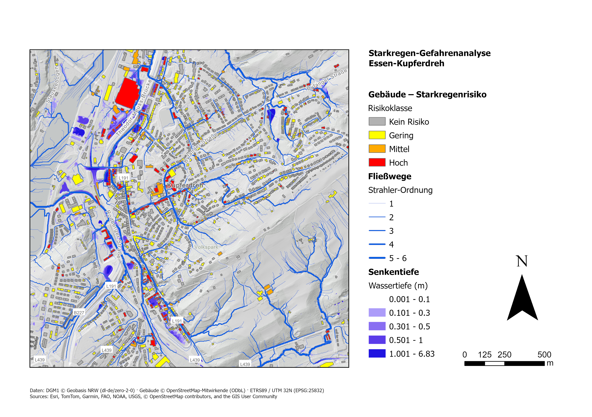
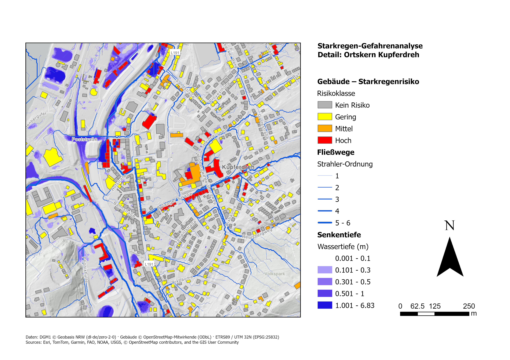

# Pluvial Flood Hazard Analysis for Buildings – Essen-Kupferdreh

[English](#pluvial-flood-hazard-analysis-for-buildings--essen-kupferdreh) | [Deutsch](#deutsch)

Terrain-based heavy-rain (*Starkregen*) hazard analysis for **Essen-Kupferdreh (NRW, Germany)** using the **1 m digital terrain model DGM1 NRW** and **ArcGIS Pro Spatial Analyst**.

The analysis finds where surface water **collects** (terrain sinks), **which way it flows** (flow paths), and assigns a **risk class to each of the 2,864 buildings** in a 2 × 2 km study area.



---

## Key results

| | |
|---|---|
| Study area | 2 × 2 km, 4 DGM1 tiles (1 m), 4 million cells |
| Elevation range | 51.5 m (Ruhr / Deilbach valley) – 177.2 m (Byfang hills) |
| Deepest terrain sink | 6.83 m |
| Largest upstream area | 1.18 km² (Deilbach) |
| Buildings analysed | 2,864 (OpenStreetMap) |
| Buildings with **high** risk | **197 (6.9 %)** – but **14.2 %** of the total building footprint |
| Buildings with any risk (classes 1–3) | **898 (31.4 %)** |

| Risk class | Buildings | Share | Footprint |
|---|---|---|---|
| 3 – High | 197 | 6.9 % | 60,272 m² |
| 2 – Medium | 94 | 3.3 % | 22,094 m² |
| 1 – Low | 607 | 21.2 % | 106,071 m² |
| 0 – None | 1,966 | 68.6 % | 234,901 m² |

**Where the risk is:** high-risk buildings are concentrated in the **valley floor**, along the railway line, the L191 and in the **town centre of Kupferdreh**, where several major flow paths meet. Buildings on the hillsides (Byfang) are largely unaffected because water drains away from them. High-risk buildings are on average larger (halls, commercial and industrial buildings next to the railway and the main road).



**Streets with the most high-risk buildings**

| Rank | Street | High | Medium | Buildings on street |
|---|---|---|---|---|
| 1 | Kupferdreher Straße | 30 | 9 | 200 |
| 2 | Byfanger Straße | 25 | 3 | 176 |
| 3 | Hinsbecker Löh | 13 | 4 | 20 |
| 4 | Colsmanstraße | 10 | 0 | 15 |
| 5 | Blockstraße | 5 | 3 | 45 |
| 6 | Niederweniger Straße | 5 | 2 | 83 |

On **Byfanger Straße** a main flow path runs directly along the road through the town centre – the detail map shows the resulting chain of high-risk buildings.

Full tables (overview, streets, all buildings with formulas): [`results/Starkregen_Gebaeude_Kupferdreh.xlsx`](results/Starkregen_Gebaeude_Kupferdreh.xlsx)

---

## Workflow

1. **Data**
   - 4 DGM1 tiles (1 × 1 km, 1 m) from OpenGeodata.NRW
   - Building footprints from OpenStreetMap (Overpass API)
   - Coordinate system ETRS89 / UTM 32N (EPSG:25832)
2. **Mosaic** – tiles merged into one continuous 32-bit float raster so that water can flow across tile borders
3. **Fill** – all terrain sinks filled up to their spill point
4. **Sink depth** – filled DGM minus original DGM = potential ponding depth per cell
5. **Flow direction (D8)** – steepest downhill neighbour for every cell
6. **Flow accumulation** – upstream area (m²) draining through every cell
7. **Flow paths** – cells with ≥ 1,000 m² upstream area, ranked by **Strahler order** (1–6) and converted to polylines
8. **Sink depth per building** – zonal statistics (maximum) inside each footprint
9. **Flow paths per building** – spatial join, highest Strahler order within 2 m
10. **Risk class** per building:

| Class | Rule |
|---|---|
| 3 – High | sink depth ≥ 0.5 m **or** flow path Strahler ≥ 4 |
| 2 – Medium | sink depth ≥ 0.3 m **or** Strahler = 3 |
| 1 – Low | sink depth ≥ 0.1 m **or** Strahler 1–2 |
| 0 – None | otherwise |

Of the 197 high-risk buildings, 135 qualify through sink depth, 74 through a major flow path and 12 through both.

The whole pipeline is automated in [`scripts/starkregen_pipeline.py`](scripts/starkregen_pipeline.py) (ArcPy) and can be re-run for any other area by changing the parameter block.

---

## Limitations

- **Topographic screening, not a hydrodynamic simulation.** The method shows *where* water collects and flows, but not water levels for a specific rainfall event (no rainfall volume, duration or infiltration). Official heavy-rain hazard maps (e.g. *Starkregengefahrenkarten*) are based on 2D hydraulic models.
- **Sewer network not considered.** In reality part of the water is drained by the sewer system.
- **Buildings are not part of the DGM.** The bare-earth model lets water flow *through* building footprints; in reality buildings divert flow.
- **Culverts and underpasses are missing in the DGM.** Road and railway embankments without their culverts create artificial sinks; the deepest values (> 3 m) mostly occur at such locations.
- **Artefacts on water surfaces:** the flat surface of Lake Baldeney produces straight, parallel flow lines that have no physical meaning.
- **Thresholds are project-specific** (1,000 m² flow path, 0.1 / 0.3 / 0.5 m, 2 m search radius) and not an official standard.
- **No validation** against observed flood extents. The Deilbach valley in Kupferdreh was affected by flooding during the July 2021 heavy-rain event, which is consistent with the pattern, but a formal comparison was not done.
- **OSM data:** building completeness and outline accuracy vary; 70 buildings at the edge lie outside the DGM extent and were rated by flow paths only.

---

## Repository structure

```
├── data/        study area (GeoJSON)
├── images/      result maps
├── results/     building risk tables (Excel, CSV)
└── scripts/     ArcPy pipeline
```

**Tools:** ArcGIS Pro 3.7 · Spatial Analyst · ArcPy · Python

**Data sources:** DGM1 © Geobasis NRW (dl-de/zero-2-0) · buildings © OpenStreetMap contributors (ODbL) · basemap Esri

---

<a name="deutsch"></a>

# Starkregen-Gefahrenanalyse für Gebäude – Essen-Kupferdreh

[English](#pluvial-flood-hazard-analysis-for-buildings--essen-kupferdreh) | [Deutsch](#deutsch)

Geländebasierte Starkregen-Gefahrenanalyse für **Essen-Kupferdreh (NRW)** auf Basis des **Digitalen Geländemodells DGM1 NRW (1 m)** mit **ArcGIS Pro Spatial Analyst**.

Die Analyse zeigt, wo sich Oberflächenwasser **sammelt** (Senken), **wie es abfließt** (Fließwege), und ordnet **jedem der 2.864 Gebäude** im 2 × 2 km großen Untersuchungsgebiet eine **Risikoklasse** zu.

## Zentrale Ergebnisse

| | |
|---|---|
| Untersuchungsgebiet | 2 × 2 km, 4 DGM1-Kacheln (1 m), 4 Mio. Zellen |
| Höhenbereich | 51,5 m (Ruhr-/Deilbachtal) – 177,2 m (Byfanger Höhen) |
| Tiefste Geländesenke | 6,83 m |
| Größtes Einzugsgebiet | 1,18 km² (Deilbach) |
| Untersuchte Gebäude | 2.864 (OpenStreetMap) |
| Gebäude mit **hohem** Risiko | **197 (6,9 %)** – aber **14,2 %** der gesamten Gebäudegrundfläche |
| Gebäude mit Risiko (Klasse 1–3) | **898 (31,4 %)** |

| Risikoklasse | Gebäude | Anteil | Grundfläche |
|---|---|---|---|
| 3 – Hoch | 197 | 6,9 % | 60.272 m² |
| 2 – Mittel | 94 | 3,3 % | 22.094 m² |
| 1 – Gering | 607 | 21,2 % | 106.071 m² |
| 0 – Kein Risiko | 1.966 | 68,6 % | 234.901 m² |

**Räumliches Muster:** Gebäude mit hohem Risiko liegen vor allem in der **Tallage** entlang der Bahnstrecke, der L191 und im **Ortskern von Kupferdreh**, wo mehrere Hauptfließwege zusammenlaufen. Gebäude an den Hängen (Byfang) sind weitgehend unbetroffen, da das Wasser dort abfließt. Gebäude mit hohem Risiko sind im Mittel größer (Hallen, Gewerbe- und Industriegebäude an Bahn und Hauptstraße).

**Straßen mit den meisten Gebäuden der Klasse Hoch**

| Rang | Straße | Hoch | Mittel | Gebäude an der Straße |
|---|---|---|---|---|
| 1 | Kupferdreher Straße | 30 | 9 | 200 |
| 2 | Byfanger Straße | 25 | 3 | 176 |
| 3 | Hinsbecker Löh | 13 | 4 | 20 |
| 4 | Colsmanstraße | 10 | 0 | 15 |
| 5 | Blockstraße | 5 | 3 | 45 |
| 6 | Niederweniger Straße | 5 | 2 | 83 |

Auf der **Byfanger Straße** verläuft ein Hauptfließweg direkt entlang der Straße durch den Ortskern – die Detailkarte zeigt die daraus entstehende Kette von Gebäuden mit hohem Risiko.

Vollständige Tabellen: [`results/Starkregen_Gebaeude_Kupferdreh.xlsx`](results/Starkregen_Gebaeude_Kupferdreh.xlsx)

## Arbeitsablauf

1. **Daten** – 4 DGM1-Kacheln (1 m) von OpenGeodata.NRW; Gebäudeumringe aus OpenStreetMap (Overpass API); ETRS89 / UTM 32N (EPSG:25832)
2. **Mosaik** – Kacheln zu einem durchgehenden 32-Bit-Float-Raster zusammengefügt
3. **Fill** – Auffüllen aller Senken bis zum Überlaufpunkt
4. **Senkentiefe** – gefülltes DGM minus Original-DGM = mögliche Einstautiefe je Zelle
5. **Fließrichtung (D8)** – steilste Abwärtsrichtung je Zelle
6. **Fließakkumulation** – Einzugsfläche (m²) je Zelle
7. **Fließwege** – Zellen mit ≥ 1.000 m² Einzugsfläche, Ordnung nach **Strahler** (1–6), Umwandlung in Linien
8. **Senkentiefe je Gebäude** – Zonale Statistik (Maximum) im Gebäudeumring
9. **Fließwege je Gebäude** – Räumliche Verbindung, höchste Strahler-Ordnung im Umkreis von 2 m
10. **Risikoklasse** je Gebäude: Hoch = Senkentiefe ≥ 0,5 m oder Strahler ≥ 4; Mittel = ≥ 0,3 m oder Strahler 3; Gering = ≥ 0,1 m oder Strahler 1–2

Der gesamte Ablauf ist im ArcPy-Skript [`scripts/starkregen_pipeline.py`](scripts/starkregen_pipeline.py) automatisiert und lässt sich über den Parameterblock für jedes andere Gebiet wiederverwenden.

## Einschränkungen

- **Topografische Gefährdungsabschätzung, keine hydrodynamische Simulation:** Die Methode zeigt, *wo* sich Wasser sammelt und abfließt, aber keine Wasserstände für ein bestimmtes Regenereignis (keine Niederschlagsmenge, Dauer oder Versickerung). Amtliche Starkregengefahrenkarten beruhen auf 2D-hydraulischen Modellen.
- **Kanalnetz nicht berücksichtigt.**
- **Gebäude sind nicht Teil des DGM:** Im Geländemodell fließt das Wasser durch die Gebäude hindurch; in der Realität wird es umgelenkt.
- **Durchlässe und Unterführungen fehlen im DGM:** Straßen- und Bahndämme ohne Durchlass erzeugen künstliche Senken; die größten Tiefen (> 3 m) liegen meist an solchen Stellen.
- **Artefakte auf Wasserflächen:** Die ebene Oberfläche des Baldeneysees erzeugt gerade, parallele Fließlinien ohne physikalische Bedeutung.
- **Schwellenwerte sind projektbezogen** und keine amtliche Vorgabe.
- **Keine Validierung** mit beobachteten Überflutungsflächen. Das Deilbachtal in Kupferdreh war beim Starkregen im Juli 2021 von Überflutungen betroffen, was zum Muster passt; ein formaler Abgleich wurde nicht durchgeführt.
- **OSM-Daten:** Vollständigkeit und Lagegenauigkeit der Gebäude variieren; 70 Gebäude am Rand liegen außerhalb des DGM-Ausschnitts und wurden nur über Fließwege bewertet.

**Werkzeuge:** ArcGIS Pro 3.7 · Spatial Analyst · ArcPy · Python

**Datenquellen:** DGM1 © Geobasis NRW (dl-de/zero-2-0) · Gebäude © OpenStreetMap-Mitwirkende (ODbL) · Hintergrundkarte Esri

---

*Konstantinos Chantzis · 2026 · MIT License*
